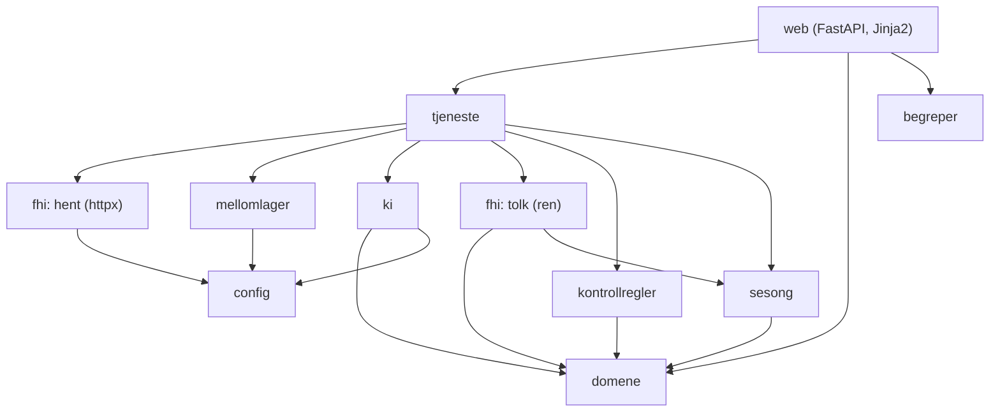
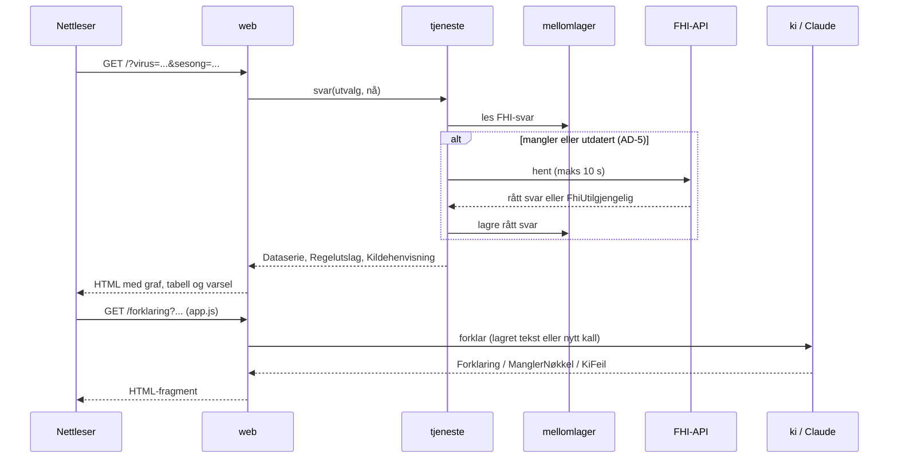

# Arkitektur: FHI Helsedata-utforsker

Dette dokumentet fastsetter beslutningene som gjør at moduler og stories som bygges hver for seg, passer sammen. Hver beslutning (AD) har fast ID, viser til krav i PRD-en og har en kort begrunnelse. Detaljer som koden selv viser, står ikke her. Arbeidsnotatene ligger i `.memlog.md` i samme mappe.

## 1. Hvorfor vi ikke bruker oppsettet i technology.md

`technology.md` beskriver en nettbutikk med kunder, betaling, innlogging, innholdstjeneste og flere tusen brukere. Vår app viser åpne, aggregerte tall for én bruker om gangen, og har ingen innlogging (NFR-8). Vi tar med ett prinsipp derfra: **zero-config med mock-fallback**. Appen starter uten nøkler, og den eneste eksterne tjenesten som krever nøkkel (Claude), faller tilbake til en fast melding (AD-6).

| I technology.md | Hvorfor vi ikke trenger det |
| --- | --- |
| PostgreSQL, SQLAlchemy, Alembic, Supabase | Vi lagrer bare kopier av FHI-svar og KI-tekster. Det er noen hundre små filer som kan slettes uten tap, fordi alt kan hentes på nytt. Vi har ingen brukere, ordrer eller relasjoner, og dermed ingenting å migrere. |
| Redis | Mellomlagringen er JSON-filer (AD-4). Med én prosess og noen få brukere gir Redis bare én tjeneste mer å drifte. |
| Next.js, React, Tailwind, TanStack Query | Hele brukerflaten er én side med et skjema, en graf og en tabell. Jinja2-maler fra FastAPI og Chart.js fra CDN dekker det, uten Node og byggesteg (AD-8). |
| Docker Compose, Caddy, Railway | Én Python-prosess startet med `uv run` er nok. Vi har ingen tjenester å koble sammen og ingen proxy. Vercel kan kjøre FastAPI direkte (AD-11). |
| JWT, bcrypt, capability-tokens, Supabase Storage | Ingen innlogging og ingen persondata (NFR-8). |
| Stripe, Vipps, Resend, Fiken, OpenRouter | Ingen betaling eller e-post. KI går direkte mot Claude med Anthropics SDK (AD-6). |
| Feature flags, plugins, backup, watchdog | Mal 2 er én ekstra rute, ikke et eget flagg. Det finnes ingen data som må tas vare på, så vi trenger ingen backup. |

## 2. Designparadigme

**Funksjonell kjerne, imperativt skall**, i én Python-pakke (`backend`).

- **Kjernen** er rene funksjoner uten nettverk, filer, klokke eller KI: `domene`, `sesong`, tolkingen i `fhi`, `kontrollregler` og `begreper`. Alt kravet om «faste regler i koden» (FR-6, FR-14–FR-19, FR-13) ligger her og testes med vanlige verdier inn og ut.
- **Skallet** gjør I/O: henting i `fhi`, `mellomlager`, `ki`, `tjeneste` og `web`. `tjeneste` setter sammen ett svar for et utvalg. `web` gjør bare HTTP og HTML.



Pilen betyr «kan importere». Kjernemodulene (`domene`, `sesong`, fhi-tolking, `kontrollregler`, `begreper`) importerer aldri skallmoduler.

## 3. Beslutninger

### AD-1 — Avhengighetsretning og ren kjerne `[ADOPTED]`

- **Binds (gjelder):** alle moduler; FR-6, FR-14–FR-19, NFR-10
- **Prevents (hindrer):** at kontrollregler eller tolking leser filer, kaller FHI eller bruker `datetime.now()`, slik at de ikke kan testes uten nett.
- **Rule (regel):** Modulene `domene`, `sesong`, `kontrollregler`, `begreper` og tolkefunksjonene i `fhi` importerer ikke `httpx`, `anthropic`, `mellomlager`, `config` eller `web`, og får tidspunkt («nå») som argument. Diagrammet i kapittel 2 er fasit for hvem som kan importere hvem.
- **Begrunnelse:** PRD-en krever at reglene står i koden og gir samme svar hver gang (kapittel 6.5). Rene funksjoner er det enkleste som oppfyller det.

### AD-2 — Domenemodellen er felles språk `[ADOPTED]`

- **Binds (gjelder):** alle moduler; FR-2, FR-4, FR-5, FR-11, NFR-3
- **Prevents (hindrer):** at web, kontrollregler og KI-prompt hver lager sin egen variant av «uke», «skjult verdi» eller «aldersgruppe».
- **Rule (regel):** `domene.py` eier dataklassene `Utvalg`, `Uke` (år, ukenummer, tester, positive, andel, og de avledede egenskapene `usikker` og `manglende`, som regnes ut i `Uke` etter definisjonene i PRD kapittel 3), `Dataserie`, `Regelutslag` og `Kildehenvisning`, og de faste listene virus → tabell (724/729/731), aldersgrupper og maler. Skjulte og manglende verdier er `None`, aldri `0`. FHI-koder (`NONSTL`, `A+B`, `80+ år`, `pos_rate`) finnes bare i `domene.py` og `fhi.py`. Maler og KI-prompt får bare norske etiketter.
- **Begrunnelse:** Begrepene i PRD kapittel 3 skal brukes likt i kode og stories. Én kilde hindrer at en skjult verdi vises som 0 (FR-11) eller at en FHI-kode slipper ut i grensesnittet (NFR-3).

### AD-3 — Henting fra FHI og en komplett dataserie

- **Binds (gjelder):** `fhi`; FR-2, FR-3, FR-6, FR-8, FR-9, FR-16, FR-17
- **Prevents (hindrer):** at grafen, tabellen og R3/R4 teller uker ulikt fordi én modul ser bare radene FHI sendte, mens en annen ser hele sesongen.
- **Rule (regel):** `fhi.hent(...)` er den eneste koden som kaller `statistikk-data.fhi.no`. Den bruker `httpx` med 10 sekunders tidsgrense, og ved tidsavbrudd, HTTP-feil eller ugyldig svar kaster den alltid `FhiUtilgjengelig`. `fhi.tolk(rått_svar, utvalg)` lager en `Dataserie` med én `Uke` for hver forventet uke i sesongen (uke 40 til uke 20, med uke 53 når året har den) frem til siste publiserte uke. En uke FHI ikke sendte, blir en manglende uke. Siste publiserte uke er den høyeste uken i FHIs dimensjonsliste `dateusedforstatistics` for tabellen. Sesonglisten (FR-3) lages også fra denne dimensjonslisten. Uten nett og uten lagret dimensjonsliste brukes reserven `sesong.sesonger_fra_dato(nå)`.
- **Begrunnelse:** Med én feiltype er reserveløsningen i FR-8 lett å skrive. Med én komplett serie bygger alle visninger og regler på de samme ukene.

### AD-4 — Mellomlagring som JSON-filer `[ADOPTED]`

- **Binds (gjelder):** `mellomlager`; FR-7, FR-8, FR-25, NFR-2
- **Prevents (hindrer):** to filformater, halvskrevne filer og at cachen havner i git.
- **Rule (regel):** Bare `mellomlager.py` leser og skriver i cache-mappen. Mappen er `CACHE_DIR` hvis den er satt, ellers `/tmp/fhi-helsedata-cache` på Vercel (miljøvariabelen `VERCEL` finnes) og `.cache/` i reporoten lokalt. `.cache/` står i `.gitignore`. Én fil per FHI-forespørsel (`fhi/<Utvalg.nøkkel>.json` og `fhi/<tabell>-dimensjoner.json`, der `Utvalg.nøkkel` i `domene` er den eneste koden som lager filnavn fra et utvalg) inneholder `{"hentet": <ISO 8601 i UTC>, "svar": <rått FHI-svar>}`. Rått svar har samme format som filene i `tests/fixtures/fhi/`. Alle filer skrives til en midlertidig fil og flyttes på plass med `os.replace`. En fil som ikke kan leses, behandles som om den ikke finnes. SQLAlchemy fjernes fra `pyproject.toml`.
- **Begrunnelse:** Vi har ingen relasjoner og ingenting som må tas vare på (se kapittel 1). Når vi lagrer det rå svaret, gjelder en rettelse i tolkingen også tall som allerede er lagret.

### AD-5 — Når lagrede tall er utdaterte

- **Binds (gjelder):** `sesong`, `tjeneste`; FR-7, FR-25
- **Prevents (hindrer):** at web, tjeneste og tester bruker ulike regler for når tall skal hentes på nytt.
- **Rule (regel):** Den rene funksjonen `sesong.er_utdatert(hentet, nå)` gir `True` når `nå − hentet` er 24 timer eller mer. Begge tidspunktene har tidssone (UTC). `tjeneste` henter på nytt når dataene er utdaterte, og alltid ved FR-25. All tid lagres i UTC og vises i norsk tid som «20.11.2026 kl. 14:05».
- **Begrunnelse:** Følger FR-7. Fast levetid virker uansett når FHI publiserer. En regel om «torsdag kl. 12:00» ville regnet gamle tall som ferske i en hel uke hvis tallene ble hentet torsdag etter kl. 12, men før FHI hadde publisert. Ett døgns forsinkelse er greit for ukentlige tall, og FR-25 dekker behovet for å hente nye tall med en gang.

### AD-6 — KI-forklaring med Claude og fast reserve `[ADOPTED]`

- **Binds (gjelder):** `ki`, `config`; FR-20, FR-21, FR-22, NFR-1, NFR-9
- **Prevents (hindrer):** at appen plukker opp en nøkkel fra skallet eller `ant auth` og oppfører seg ulikt hos ulike utviklere, og at feil fra KI-en stopper resten av siden.
- **Rule (regel):** Bare `ki.py` importerer `anthropic`. Modellen er `claude-haiku-5-5` (kan overstyres med `ANTHROPIC_MODEL`). `config.les_innstillinger()` laster `.env` fra reporoten (`load_dotenv(override=True)`, slik at `.env` vinner over skallet) og returnerer en `Innstillinger`-dataklasse. Bare `web` kaller funksjonen, én gang ved oppstart. Ingen modul laster `.env` ved import. På Vercel kommer nøkkelen fra prosjektets miljøvariabler. Klienten lages bare med eksplisitt `api_key=` når nøkkelen finnes. Uten nøkkel kalles ikke Claude. `ki.forklar(...)` returnerer alltid ett av tre utfall: `Forklaring(tekst)`, `ManglerNøkkel` eller `KiFeil`, og kaster aldri videre. Prompten ligger i `prompts/forklaring.md` og får bare utvalg, tolkede tall, regelutslag og kildehenvisning. Teksten for `ManglerNøkkel` og `KiFeil` er fast og står i malen (FR-22). `.env.example` viser `ANTHROPIC_API_KEY=` og `ANTHROPIC_MODEL=`.
- **Begrunnelse:** Dette er zero-config/mock-fallback fra `technology.md`. Haiku er den minste og billigste modellen, og den holder til en tekst på høyst 120 ord. Med eksplisitt nøkkel virker UJ-4 likt for alle.

### AD-7 — Mellomlagret KI-forklaring

- **Binds (gjelder):** `ki`, `mellomlager`; FR-20, FR-25, SM-4
- **Prevents (hindrer):** nye KI-kall (og en ny tekst) hver gang samme tall vises, og at FR-25 lager ny forklaring når tallene ikke har endret seg.
- **Rule (regel):** Nøkkelen er SHA-256 av en kanonisk JSON (`sort_keys=True`) med utvalg, tolkede uker, regelutslag, innholdet i promptfilen og modellnavn. Filen `ki/<nøkkel>.json` inneholder `{"laget": ..., "modell": ..., "tekst": ...}`. Hentetidspunktet er ikke med i nøkkelen. Bare `Forklaring` lagres, ikke `ManglerNøkkel` eller `KiFeil`.
- **Begrunnelse:** FR-25 krever at forklaringen gjenbrukes når tallene er uendret. Når en endret prompt gir ny nøkkel, blir lagrede tekster ikke liggende etter at vi har endret prompten. Lagrede tekster gjør også SM-4 lettere å sjekke.

### AD-8 — Server-HTML med Jinja2, Chart.js fra CDN `[ADOPTED]`

- **Binds (gjelder):** `web`, `templates/`, `static/`; FR-9–FR-12, FR-19, NFR-4–NFR-7, NFR-11
- **Prevents (hindrer):** et byggesteg med Node, og at grafen og tabellen viser ulike tall.
- **Rule (regel):** Siden lages på serveren med Jinja2. Tabell, varsel, kildehenvisning og begrepsforklaringer (`<details>`/`<summary>`, som virker med tastatur) står i HTML og virker uten JavaScript. Grafen tegnes av Chart.js 4.6.1 fra `cdn.jsdelivr.net` med fast versjon og `integrity`-attributt. Grafen leser tallene fra en `<script type="application/json">`-blokk som lages fra samme `Dataserie` som tabellen. Manglende uker er `null` (brudd i linjen). Usikre uker har en annen punktform, ikke bare en annen farge, og mal 2 bruker hel og stiplet linje. All egen JavaScript ligger i `static/app.js`.
- **Begrunnelse:** Siden er liten nok til at vi ikke trenger et rammeverk. Chart.js har punktformer og stiplede linjer (NFR-7). Når tabellen alltid står i HTML, er tallene tilgjengelige også uten graf (NFR-6).

### AD-9 — Ruter og lastemønster

- **Binds (gjelder):** `web`, `static/app.js`; FR-1–FR-5, FR-8, FR-20, FR-22, FR-25, NFR-2
- **Prevents (hindrer):** at siden venter på KI-en, at skjermleserbrukere ikke får vite når forklaringen kommer, at et dobbelttrykk starter flere kall mot FHI, og at oppdatering av siden sender skjemaet på nytt.
- **Rule (regel):**
  - `GET /` med utvalget som query-parametre (`mal`, `virus`, `sesong`, `alder`) viser skjema og resultat. Uten parametre vises bare skjemaet. Ugyldige parametre gir en norsk melding og ingen henting (FR-5). Validering skjer bare i `domene.Utvalg.fra_parametre`.
  - `GET /forklaring` med samme parametre returnerer et HTML-fragment med KI-forklaringen. `app.js` henter det etter at siden er vist og setter det inn i forklaringsområdet. Området har `aria-live="polite"` og inneholder «Forklaringen lages …» fra start (FR-20). Hvis kallet feiler (nettverksfeil eller annen status enn 200), setter `app.js` inn FR-22-meldingen «forklaringen kunne ikke lages akkurat nå». Teksten legges av malen i et `data-feiltekst`-attributt på området, slik at alle faste tekster står i malene og ikke i JavaScript.
  - `POST /hent-nyeste` (skjema med samme felt) henter på nytt uten mellomlagring og svarer med `303` til `GET /` for samme utvalg. `app.js` deaktiverer knappen når skjemaet sendes. I `tjeneste` sørger en lås per utvalg for at samtidige forespørsler deler ett kall til FHI.
  - Brukeren ser aldri tekniske feilkoder. `FhiUtilgjengelig` gir FR-8-meldingen, med eller uten lagrede tall.
- **Begrunnelse:** Graf og tabell vises innen 5 sekunder selv om KI-en er treg (NFR-2). Mønsteret med POST og omdirigering gjør at FR-25-knappen ikke sendes på nytt hvis brukeren oppdaterer siden.

### AD-10 — Tester uten nett og uten nøkkel `[ADOPTED]`

- **Binds (gjelder):** `tests/`; NFR-10, SM-1, SM-2, SM-3
- **Prevents (hindrer):** at en test gjør et ekte kall mot FHI eller Claude og blir treg, ustabil eller koster penger.
- **Rule (regel):** `pytest` kjøres med `pytest-socket` (`--disable-socket`), slik at alle nettverkskall feiler. HTTP mot FHI mockes med `respx` og svar fra `tests/fixtures/fhi/`. KI testes med en falsk klient og tekster fra `tests/fixtures/ki/`. Konstruerte data for grensetilfellene i R1–R5 ligger i `tests/fixtures/konstruert/`. Testsettet med 10 spørsmål (SM-1–SM-3) har fasit hentet manuelt fra FHI i `tests/fixtures/testsett/`, med hentedato i hver fil. Testene laster aldri `.env`. De lager `Innstillinger` direkte, uten nøkkel og med `CACHE_DIR` lik `tmp_path`, og overstyrer `les_innstillinger` i app-testene. `ruff check` og `ruff format --check` skal bestå før commit.
- **Begrunnelse:** Med nettsperre kan ingen test ved et uhell ringe ut, slik NFR-10 krever. Fixturene er samme format som cachen (AD-4), så vi trenger bare én tolker.

### AD-11 — Kjøring lokalt og valgfritt på Vercel `[ADOPTED]`

- **Binds (gjelder):** drift; NFR-1, NFR-9, FR-8
- **Prevents (hindrer):** oppsett som bare virker på én maskin, og at noen tror Vercel gir varig mellomlagring.
- **Rule (regel):** Lokalt: `cd backend && uv run uvicorn backend.web:app --reload`. Appen starter uten `.env`. Vercel er valgfritt: FastAPI-appen pekes ut med `[tool.vercel] entrypoint` i `pyproject.toml`, og `ANTHROPIC_API_KEY` settes i prosjektets miljøvariabler. På Vercel er `/tmp` flyktig og gjelder bare én instans, så reserven i FR-8 virker bare når samme instans har hentet tallene før.
- **Begrunnelse:** Vercel kjører FastAPI uten egen konfigurasjon. Vi beskriver begrensningen ved `/tmp` i stedet for å legge til en database bare for publisering.

## 4. Felles konvensjoner

| Tema | Konvensjon |
| --- | --- |
| Navn | Moduler, funksjoner og dataklasser på norsk etter begrepene i PRD kapittel 3 (`Utvalg`, `Uke`, `Dataserie`, `kontrollregler.vurder`). Ord fra rammeverk og biblioteker beholdes på engelsk. |
| Regelutslag | `kontrollregler.vurder(serie) -> list[Regelutslag]`. `Regelutslag` har `regel` (`"R1"`–`"R5"`) og en ferdig setning på enkel norsk med de faktiske tallene, for eksempel «6 av 20 uker har færre enn 30 tester». Tom liste betyr ingen varsel. Mal 2 kaller `vurder` én gang per sesong (FR-24). |
| Kildehenvisning | Lages bare av `domene.kildehenvisning(tabell, hentet)` og brukes både under grafen og ved KI-forklaringen (FR-12, FR-20). |
| Tall og datoer | Andel vises med én desimal og komma («20,8 %»), og store tall med mellomrom som tusenskille. Uker vises som «uke 50». Hentetidspunkt vises som «20.11.2026 kl. 14:05». Formatering skjer bare i Jinja2-filtre i `web`. |
| Feil | Skallet fanger feil ved grensen: `FhiUtilgjengelig` i `tjeneste`, KI-utfall i `ki`. Rutene i `web` viser bare faste norske tekster. Tekniske detaljer går til logg (`logging`, nivå INFO). |
| Konfigurasjon | Bare `config.py` leser miljøvariabler, og bare via `les_innstillinger()`: `ANTHROPIC_API_KEY`, `ANTHROPIC_MODEL`, `CACHE_DIR`, `VERCEL`. Alle har standardverdier eller kan mangle. |
| Faste tekster | Begrepsforklaringer i `begreper.py` (FR-13). Feil- og varseltekster i malene. KI-prompt i `prompts/forklaring.md`. Ingen tekst lages av KI utenom forklaringen. |

## 5. Stack

| Navn | Versjon |
| --- | --- |
| Python | 3.13 |
| uv_build (byggesystem for uv) | >=0.12.19,<0.13 |
| FastAPI | 0.165.0 |
| Uvicorn | 0.54.0 |
| Jinja2 | 3.1.6 |
| python-multipart (skjema-POST) | 0.0.34 |
| httpx | 0.28.1 |
| anthropic (Python-SDK) | 2.11.0 |
| Claude-modell | `claude-haiku-5-5` |
| python-dotenv | 1.2.4 |
| tzdata (for `Europe/Oslo` på Vercel) | 2026.6 |
| Chart.js (CDN) | 4.6.1 |
| pytest | 9.2.0 |
| pytest-socket | 0.8.1 |
| respx | 0.23.1 |
| ruff | 0.17.6 |

Versjonene er sjekket mot PyPI og npm 20. november 2026. `pyproject.toml` bruker `>=` med disse som minimum, og `uv.lock` låser de nøyaktige versjonene.

## 6. Mappestruktur

```text
fhi-helsedata/
  .env.example              # ANTHROPIC_API_KEY=, ANTHROPIC_MODEL=
  .env                      # bare lokalt, i .gitignore (NFR-9)
  .cache/                   # mellomlagring lokalt, i .gitignore (AD-4)
  backend/
    pyproject.toml          # avhengigheter, ruff, pytest, [tool.vercel]
    uv.lock
    src/backend/
      config.py             # miljøvariabler og cache-mappe
      domene.py             # Utvalg, Uke, Dataserie, Regelutslag, Kildehenvisning, faste lister
      sesong.py             # ISO-uker, sesonger, er_utdatert (AD-5)
      fhi.py                # hent (httpx) og tolk (ren)
      mellomlager.py        # JSON-filer for FHI-svar og KI-tekster
      kontrollregler.py     # R1–R5, rene funksjoner
      begreper.py           # sju faste begrepsforklaringer
      ki.py                 # Claude, tre utfall
      prompts/forklaring.md
      tjeneste.py           # setter sammen svaret for et utvalg, lås per utvalg
      web.py                # FastAPI-app og ruter
      templates/            # base.html, index.html, _forklaring.html
      static/               # app.js, style.css
    tests/
      fixtures/fhi/         # lagrede FHI-svar (SM-1, SM-2)
      fixtures/ki/          # lagrede KI-svar (SM-4)
      fixtures/konstruert/  # grensetilfeller R1–R5 (SM-3)
      fixtures/testsett/    # fasit for de 10 testspørsmålene (SM-1–SM-3)
      test_*.py
```



## 7. Krav og hvor de bygges

| Krav | Bygges i | Styres av |
| --- | --- | --- |
| FR-1–FR-5 (velge mal og utvalg, hindre ugyldige valg) | `domene`, `web`, `templates/` | AD-2, AD-9 |
| FR-6 (riktige tall), SM-1 | `fhi`, `domene` | AD-1, AD-3 |
| FR-7, FR-8 (mellomlagring, FHI svarer ikke) | `mellomlager`, `sesong`, `tjeneste` | AD-3, AD-4, AD-5 |
| FR-9–FR-11 (graf, usikre uker, tabell) | `templates/`, `static/app.js` | AD-8 |
| FR-12 (kildehenvisning), SM-2 | `domene` | AD-2, konvensjon «Kildehenvisning» |
| FR-13 (begrepsforklaringer) | `begreper`, `templates/` | AD-8 |
| FR-14–FR-19 (R1–R5 og varsel), SM-3 | `kontrollregler`, `templates/` | AD-1, AD-3, konvensjon «Regelutslag» |
| FR-20–FR-22 (KI-forklaring), SM-4 | `ki`, `prompts/` | AD-6, AD-7, AD-9 |
| FR-23, FR-24 (mal 2, strekkmål) | `tjeneste` (to serier), `kontrollregler` per sesong, `app.js` | AD-3, AD-8 |
| FR-25 (hente nyeste tall nå) | `web` (`POST /hent-nyeste`), `tjeneste`, `app.js` | AD-5, AD-7, AD-9 |
| NFR-1, NFR-9 (uten nøkkel, nøkler utenfor repoet) | `config`, `ki` | AD-6 |
| NFR-2 (svartid) | `web`, `app.js` | AD-9 |
| NFR-3–NFR-7, NFR-11 (språk og tilgjengelighet) | `templates/`, `static/` | AD-2, AD-8 |
| NFR-8 (bare åpne, aggregerte data) | hele appen | kapittel 1 (ingen innlogging, ingen persondata) |
| NFR-10 (tester uten nett og nøkkel) | `tests/` | AD-10 |

## 8. Utsatt

| Hva | Hvorfor det kan vente |
| --- | --- |
| Nøyaktig format på FHI-forespørselen (CSV eller JSON) og tolking av FLAGG-kolonnen | Bare `fhi.py` kjenner formatet (AD-3). Det avgjøres i første story mot ekte svar og lagres som fixture. |
| Tekstene i de sju begrepsforklaringene og i prompten | PRD åpent spørsmål 2. Skrives før FR-13 og FR-20 bygges, og prøves ut i brukertestingen. |
| De 10 spørsmålene i testsettet og fasiten | PRD åpent spørsmål 3. Hentes manuelt fra FHI før SM-1-testene skrives. |
| `max_tokens`, `effort` og tidsgrense for Claude | Innstillinger inne i `ki.py`. Påvirker ingen andre moduler. |
| Nøyaktig `[tool.vercel]`-oppsett og hvilke Python-versjoner Vercel støtter | Vercel er valgfritt. Sjekkes den dagen vi publiserer. |
| Fyrtårnsystemet, mal 3 og mal 4 | Utenfor v1 (PRD kapittel 9). `domene` og `fhi` kan utvides uten å endre reglene. |
| Opprydding i gamle cachefiler | Filene er små, og `/tmp` på Vercel tømmes uansett. Tas opp hvis mappen blir stor. |
